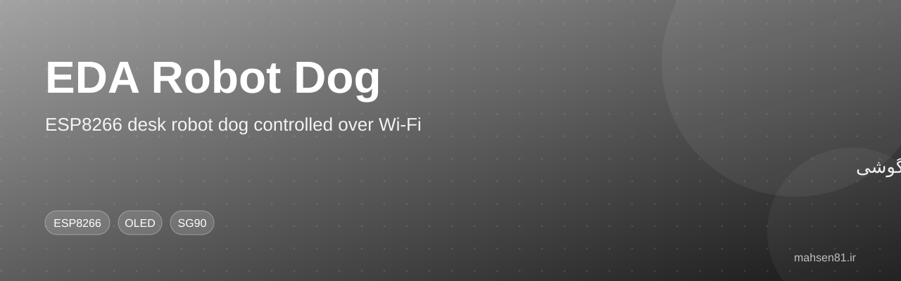

<!-- gen:header -->
<p align="center"></p>

<h1 align="center">EDA Robot Dog</h1>
<p align="center"><b>سگ‌ربات رومیزی با ESP8266، کنترل از گوشی</b><br><i>ESP8266 desk robot dog controlled over Wi-Fi</i></p>
<p align="center">  </p>

<div dir="rtl">

## ✨ امکانات

- کنترل با وای‌فای
- حالت چهره، ساعت و آب‌وهوا روی OLED
- ۴ سروو برای راه رفتن

</div>

## 🚀 Quick start

```bash
Read PROJECT.md
```

---

<p align="center">ساخته‌شده توسط <a href="https://mahsen81.ir"><b>محسن جباره‌اصل</b></a> — برنامه‌نویسی، طراحی سایت، ربات و هوش مصنوعی<br>
Built by <a href="https://mahsen81.ir">Mohsen Jabbareh-Asl</a> · ⭐ اگر مفید بود، ستاره بدهید · Need a custom version? <a href="https://mahsen81.ir">Get in touch</a></p>
